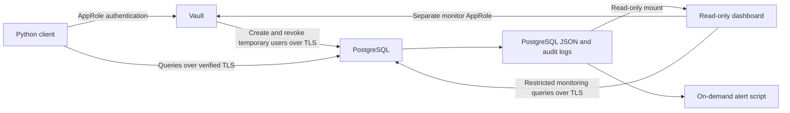

# Zero-Trust PostgreSQL with HashiCorp Vault

A reproducible security lab replacing a shared application database password
with unique, short-lived credentials issued by Vault.

Built with PostgreSQL 16, pgaudit, Vault 2.2.1, Docker Compose,
OpenSSL and Python. Tested on an Oracle Cloud Ubuntu ARM64 VM.

## Architecture



A private CA signs PostgreSQL's certificate. Database clients verify both
the CA and hostname. Vault uses HTTP in this development lab.

## Security controls

- TLS-only database access with client-side `verify-full`.
- SCRAM authentication and rejection of remote superuser login.
- Separate application, analyst, administration and monitoring identities.
- Column-level restrictions for analysts.
- AppRole policies restricting which credentials each identity can request.
- Dynamic database credentials with 30-second demo leases.
- Bootstrap database password rotation and restart recovery.
- PostgreSQL and Vault audit trails.
- Monitoring for failed logins, off-hours SQL and high SELECT counts.

## Quick start

Prerequisites: Linux, Docker Engine with Compose v2, OpenSSL,
Python 3.8 or newer, Bash, curl and Git.

```bash
git clone https://github.com/ReHonor/zero-trust-postgres-vault.git
cd zero-trust-postgres-vault
bash start.sh
bash demo.sh
```

`start.sh` creates local certificates and random credentials when absent,
starts the lab and configures Vault and the dashboard.
Keep `.env` and private keys out of Git.

## Dashboard and monitoring

Open http://127.0.0.1:8080 on the VM, or create an SSH tunnel from your PC:

```bash
ssh -N -L 8080:127.0.0.1:8080 -i <ssh-key> ubuntu@<vm-address>
```

Then open http://127.0.0.1:8080 on your PC.
Username: `viewer`. Read `DASHBOARD_PASSWORD` locally from `.env`.

```bash
bash scripts/dashboard-check.sh
bash scripts/monitor.sh --minutes 5
python3 scripts/monitor-test.py
```

Monitoring is an on-demand report. Exit codes: 0=no alerts,
1=alerts, 2=input/configuration/read error.
SELECT counts measure statements, not rows returned.

## Before/after comparison

The intentionally insecure baseline uses fake data, a committed fake
password, no TLS and a superuser application account.
It publishes no host ports.

```bash
bash baseline/run.sh up
bash baseline/run.sh audit
bash baseline/run.sh audit-hardened
bash baseline/run.sh down
```

The hardened audit connects the toolbox to the hardened network.
Packet capture additionally requires privileged network-namespace access.

## CI and remaining findings

GitHub Actions checks script syntax, monitoring tests, Gitleaks rules
and Git history, supported configuration files and four container images.

Script tests, Gitleaks and configuration checks have passed.
Image scans have unresolved HIGH/CRITICAL findings; CI is not fully green.
Two documented configuration exceptions cover root initialization in
PostgreSQL and the lab packet-capture toolbox.
They do not suppress image vulnerabilities.

Vault 2.2.1 passed isolated startup, restart recovery, dashboard and demo
checks before promotion. Detailed `gosu` analysis was deliberately deferred.
A passing scan would not establish production readiness.

## Limitations

This is an educational lab. Vault runs in development mode with HTTP,
in-memory state and a bootstrap root token. Restarting it clears its state;
the recovery scripts restore lab configuration and issue fresh identities.
Host administrators with Docker access remain privileged.
Logs can contain sensitive information and are not tamper-proof.

## Documentation

- [Before/after findings](docs/09-baseline-findings.md)
- [Monitoring](docs/10-monitoring.md)
- [CI security policy](docs/11-ci-security.md)
- [Vault upgrade verification](docs/12-vault-upgrade.md)
- [Presentation guide](docs/13-demo-guide.md)
- [Project progress](PROGRESS.md)

License: [MIT](LICENSE).

## Interactive web demo

Open `/demo/` using the existing dashboard login and SSH tunnel. The 38 options
cover normal access, permission denials, identity boundaries, TLS, expiry,
revocation, audit evidence, monitoring and the insecure baseline.
Runs show progress, an actual outcome and evidence. Table writes are rolled
back; audit records and sequence counters can still change.

    bash scripts/run-demo.sh
    bash scripts/run-dashboard.sh

The trusted startup helper configures a limited demo broker; the web services
receive no Vault root token or Docker socket. Read [the web demo guide](docs/14-web-demo.md)
for permissions, isolation, limitations and troubleshooting.
